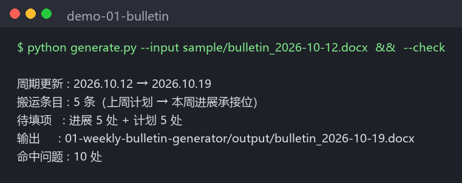
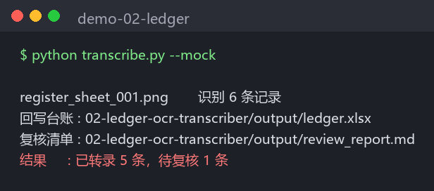
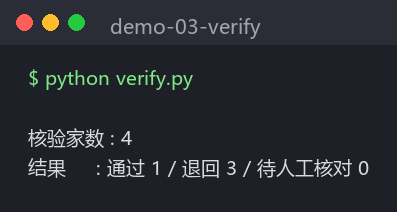

# Office Automation Toolkit · 行政采购岗自动化三件套

> Three small Python tools inspired by recurring administrative and procurement paperwork during an internship: generate a weekly bulletin, transcribe registers, and compare supplier intake forms with license PDFs. The included samples are **synthetic** and generated by `make_sample.py`.

## 为什么有这个 repo

实习期间我负责一个产业园建设项目的行政采购与台账工作，每周都要重复三件事：

1. 把上周的《周进展通报》手工另存成新一周的版本（改日期、搬计划、校序号）；
2. 把纸质登记表（用印/验收/巡检）逐行誊进 Excel 台账；
3. 供应商准入时，拿着登记表逐家核对营业执照 PDF。

三件事都有固定套路，也容易因重复录入而出错。我把这些通用流程整理成三个可复现的演示脚本；自动生成的内容仍需人工检查。仓库仅包含演示代码与虚构样张，不代表这些脚本已被实习单位正式采用。

## 目录

| # | 工具 | 解决什么 | 怎么跑 |
|---|------|----------|--------|
| 01 | [weekly-bulletin-generator](01-weekly-bulletin-generator/) | 每周通报另存新版：日期平移、上周"下周计划"搬入本周进展、待填位生成、发布前校验 | `python generate.py --input sample/bulletin_2026-10-12.docx` |
| 02 | [ledger-ocr-transcriber](02-ledger-ocr-transcriber/) | 手写登记表扫描件 → OCR → 分列装配 → 规则校验 → 回写 Excel（存疑格黄底）→ 复核清单 | `python transcribe.py`（或 `--mock` 离线演示） |
| 03 | [supplier-intake-verifier](03-supplier-intake-verifier/) | 供应商准入辅助检查：信用代码校验位、登记表与执照字段、营业期限、品类文本匹配；产出供人工复核的填法文本块 | `python verify.py` |

每个工具目录下都有 `make_sample.py`，仓库也附有已生成的虚构样张，便于直接试用和重新生成。

## 快速开始

```bash
# 在仓库主页点绿色 Code 按钮复制 clone 地址，然后：
git clone <复制到的地址>
cd office-automation-toolkit
pip install -r requirements.txt

# 仅运行 02 的真实 OCR 或 03 的扫描版 PDF 样张时，还需安装 PaddlePaddle CPU 推理引擎：
python -m pip install paddlepaddle==3.2.0 -i https://www.paddlepaddle.org.cn/packages/stable/cpu/

# 01 周报生成（无额外依赖，秒出）
cd 01-weekly-bulletin-generator && python make_sample.py && python generate.py --input sample/bulletin_2026-10-12.docx

# 02 台账转录（PaddleOCR 首次运行会下载模型；--mock 可完全离线）
cd ../02-ledger-ocr-transcriber && python make_sample.py && python transcribe.py --mock

# 03 供应商核验（执照是扫描件版式，自动走 OCR）
cd ../03-supplier-intake-verifier && python make_sample.py && python verify.py
```

## 效果截图

**01 周进展通报生成**：周期自动平移、上周计划搬入承接位、`--check` 报出新模板的全部待填项



**02 台账 OCR 转录**：仿手写样张（输入见 [sample/sheets/register_sheet_001.png](02-ledger-ocr-transcriber/sample/sheets/register_sheet_001.png)）→ 6 条记录，漏填经办人被拦进待复核



**03 供应商准入核验**：4 家虚构供应商，埋的 3 处问题（坏校验位/过期执照/资本不一致）逐项拦下



## 设计上的几个取舍

- **存疑项交给人复核。** 02 会将规则校验发现的问题标黄并写进复核清单；03 对解析不出的证照字段给出“暂缓”结论。OCR 失败会报错，不会自动用演示标注代替真实识别。规则只能辅助检查，不能代替对原件、企业登记信息和业务准入要求的人工核验。
- **校验位是真的。** 03 里的统一社会信用代码校验按 GB 32100-2015 的权重（3^i mod 31）实现，demo 里故意埋了一个坏校验位、一张过期执照、一处注册资本不一致，跑一遍就能看到它们被逐项拦截。
- **样张可重新生成。** 样张、登记表、执照 PDF 由 `make_sample.py` 程序化生成（含仿手写样张），不依赖真实业务文件。
- **兼容性踩坑记录。** PaddleOCR 3.x 在部分 Windows 环境需要 `enable_mkldnn=False` 规避 oneDNN 的 PIR 算子问题，代码里已内置并注释了原因。

## 运行环境

- Python 3.10+（开发环境为 3.12，Windows）
- 依赖见 [requirements.txt](requirements.txt)：01 需要 `python-docx`；02 的 `--mock` 模式仍需要 `openpyxl`；03 需要 `openpyxl`、`pymupdf`，扫描版 PDF 的 OCR 模式还需要可用的 PaddleOCR 与 PaddlePaddle 环境。重新生成样张另需 `Pillow` 等相应依赖。
- CPU 版 PaddlePaddle 安装命令来自 [PaddleOCR 官方文档](https://www.paddleocr.ai/main/en/version3.x/paddlepaddle_installation.html)。首次 OCR 运行还需下载模型，网络不可用时可先运行 02 的 `--mock` 演示。

## 声明

- 本仓库所有公司名、人名、证件号、日期、金额均为**程序生成的虚构数据**，与任何真实企业无关；
- 样张执照为自行排版的演示版式，印有"虚构数据·仅供演示"水印，不构成任何证照仿制；
- 这是用于展示通用处理流程的演示仓库；使用前请自行核对源文件的公开权限与实际业务规则。

## License

MIT
